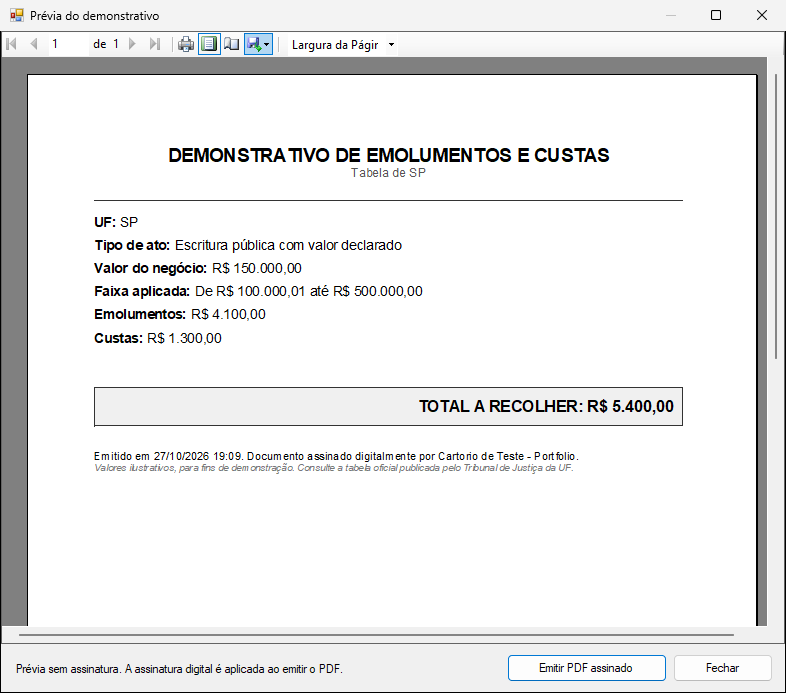

# Calculadora de emolumentos

App WinForms (.NET Framework 4.8) que calcula emolumentos e custas de cartório a partir da UF, do tipo de ato e do valor do negócio, usando a tabela de faixas de cada estado. O resultado pode ser emitido como PDF assinado digitalmente.


## Como rodar

Na pasta `01-calculadora-emolumentos`:

```bash
cp .env.example .env
docker compose up -d
```

O `docker compose` sobe um SQL Server na porta 14331 e roda os scripts de `database/` (schema e dados de exemplo).

Depois, abra `src/Emolumentos.sln` no Visual Studio 2022 e rode o projeto `Emolumentos.WinForms`. Os testes rodam com:

```bash
dotnet test src/Emolumentos.sln
```

## Estrutura

```
src/
  Emolumentos.Dominio        cálculo, entidades e exceções
  Emolumentos.Dados          repositório com ADO.NET
  Emolumentos.Apresentacao   presenter e interface da view (MVP)
  Emolumentos.Documentos     RDLC, geração do PDF e assinatura
  Emolumentos.WinForms       telas
  Emolumentos.Testes         MSTest (52 testes)
```

O formulário implementa `ICalculoView` e só repassa eventos e exibe dados. Toda a decisão fica no `CalculoPresenter`, que é testado com uma view falsa.

## Regras do cálculo

- Os limites das faixas são inclusivos: 20.000,00 fica na primeira faixa e 20.000,01 na segunda. `ValorAte` nulo significa faixa sem teto.
- O valor é arredondado para centavos antes de procurar a faixa.
- Procuração e reconhecimento de firma têm valor fixo (`TipoAto.ExigeValor = 0`), e o campo de valor fica desabilitado.
- UF sem tabela, ato sem tabela e valor fora de qualquer faixa geram exceções específicas, com mensagem para o usuário.

O banco de exemplo tem SP, MG e PR. O RJ está cadastrado sem faixas, para testar o caso de UF sem tabela. Os valores são ilustrativos e não correspondem às tabelas oficiais dos tribunais.

## Demonstrativo em PDF

Depois de calcular, dá para ver uma prévia no ReportViewer ou emitir direto o PDF assinado. Prévia e PDF usam o mesmo relatório (`Relatorios/DemonstrativoEmolumentos.rdlc`).



O PDF é assinado com iText no padrão PAdES (SHA-256). Exemplo gerado: [docs/exemplo-demonstrativo-assinado.pdf](docs/exemplo-demonstrativo-assinado.pdf).

Na primeira execução, o app cria um certificado autoassinado em `%LOCALAPPDATA%\Emolumentos\certificado-teste.pfx`. Por isso, leitores de PDF mostram a assinatura como íntegra, mas de identidade desconhecida. Para usar um certificado ICP-Brasil A1, basta trocar o caminho e a senha no `App.config`.

Os testes de integração geram o PDF de verdade e conferem o texto, a assinatura e a detecção de alteração feita depois de assinar.

Para editar o layout no Visual Studio é preciso a extensão Microsoft RDLC Report Designer.

O iText usa licença AGPL. Para um projeto aberto como este, tudo bem; um produto fechado precisaria da licença comercial.
