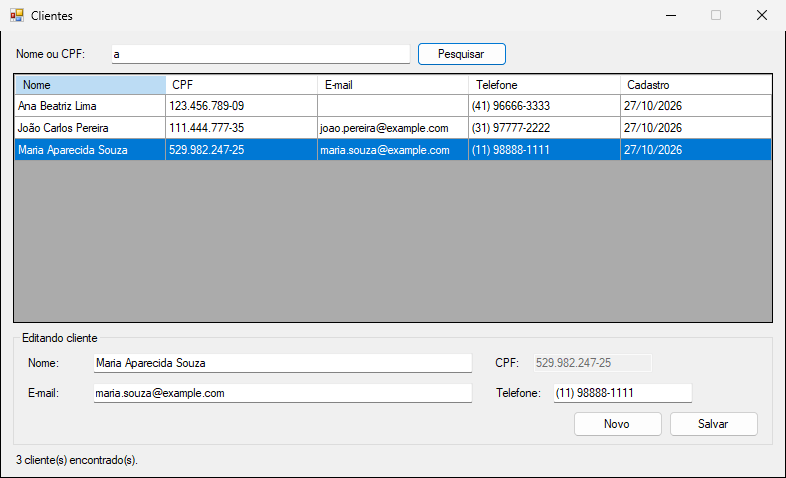
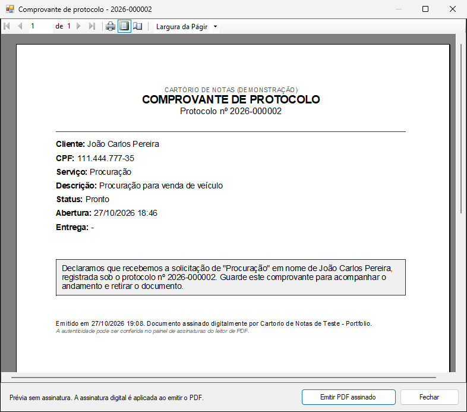
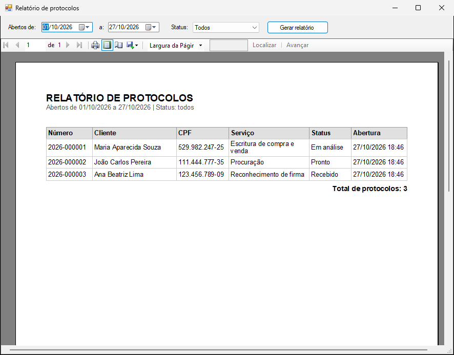

# Protocolo de cartório

Sistema de atendimento em WinForms (.NET Framework 4.8) com Entity Framework 6. Tem cadastro de clientes, abertura de protocolo, acompanhamento de status (Recebido → Em análise → Pronto → Entregue), busca por número ou CPF, comprovantes em PDF assinado e um relatório de protocolos.


## Como rodar

Na pasta `02-protocolo-cartorio`:

```bash
cp .env.example .env
docker compose up -d
```

O banco sobe na porta 14332, já com três clientes e três protocolos de exemplo. Depois, abra `src/Cartorio.sln` no Visual Studio 2022 e rode o projeto `Cartorio.WinForms`. Os testes rodam com:

```bash
dotnet test src/Cartorio.sln
```

## Estrutura

```
src/
  Cartorio.Entidades    Cliente, Protocolo, ProtocoloHistorico, StatusProtocolo
  Cartorio.Negocio      serviços, validação de CPF, regras de status, interfaces dos repositórios
  Cartorio.Dados        DbContext (EF6) e repositórios
  Cartorio.Documentos   RDLC, PDF e assinatura
  Cartorio.WinForms     telas
  Cartorio.Testes       MSTest (78 testes)
```

As interfaces de repositório ficam em `Negocio` e são implementadas em `Dados`. Assim, as regras são testadas com repositórios em memória, sem banco.

O EF6 é Code First mapeado para o banco que já existe: o schema vem dos scripts em `database/` e o inicializador do EF fica desligado. Cada operação abre e fecha o próprio `DbContext`.

## Regras

- O CPF é validado pelos dígitos verificadores, guardado só com números, não pode se repetir e não muda depois do cadastro.
- O status avança um passo por vez e o protocolo entregue não muda mais. A entrega pede confirmação e preenche a data de entrega.
- Toda mudança de status grava uma linha no histórico, na mesma transação.
- O número do protocolo segue o formato `AAAA-NNNNNN` e recomeça a cada ano. Se duas estações gerarem o mesmo número ao mesmo tempo, o índice único do banco impede a duplicação e o usuário recebe uma mensagem para tentar de novo.

Erros de regra aparecem como aviso. Falha de conexão orienta a subir o container. Os demais erros mostram uma mensagem genérica e são gravados em `%LOCALAPPDATA%\CartorioProtocolo\erros.log`.



## Documentos

O comprovante de protocolo e o comprovante de entrega saem em PDF assinado (iText, PAdES), com prévia no ReportViewer antes de gerar o arquivo. O de entrega só é liberado para protocolo entregue, e essa regra fica em `ProtocoloServico`, não na tela. O app também oferece o comprovante logo depois de abrir um protocolo ou de concluir a entrega.



O relatório de protocolos filtra por período de abertura e status. Ele usa um dataset numa tabela (Tablix) com cabeçalho repetido em cada página, total e numeração de páginas. A barra do ReportViewer exporta para PDF, Excel e Word.



Exemplos gerados: [comprovante de protocolo](docs/exemplo-comprovante-protocolo.pdf), [comprovante de entrega](docs/exemplo-comprovante-entrega.pdf) e [relatório](docs/exemplo-relatorio-protocolos.pdf).

O certificado é autoassinado e criado em `%LOCALAPPDATA%\CartorioProtocolo\` na primeira execução. Em produção seria um certificado ICP-Brasil A1, configurado no `App.config`. O iText usa licença AGPL.
