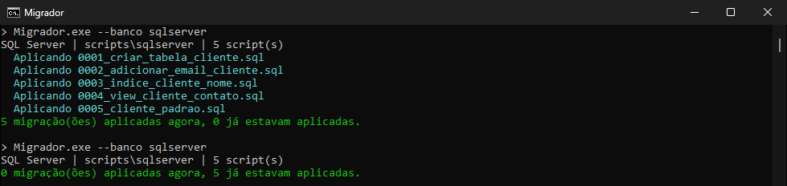

# Migrador de scripts SQL

Ferramenta de console em C# (.NET Framework 4.8) que aplica scripts de banco em ordem e registra os aplicados na tabela `historico_migracao`. Funciona com SQL Server e PostgreSQL, e os scripts de exemplo podem rodar mais de uma vez sem erro.



## Como rodar

Na pasta `03-migracoes-idempotentes`:

```bash
cp .env.example .env
docker compose up -d
dotnet build src/Migrador.sln
```

Ainda na pasta do projeto:

```bash
.\src\Migrador.Console\bin\Debug\net48\Migrador.exe --banco sqlserver --simular
.\src\Migrador.Console\bin\Debug\net48\Migrador.exe --banco sqlserver
.\src\Migrador.Console\bin\Debug\net48\Migrador.exe --banco postgres
```

| Opção | |
|---|---|
| `--banco sqlserver\|postgres` | obrigatória |
| `--conexao "..."` | se omitida, usa a do `Migrador.exe.config`, que já aponta para o Docker |
| `--pasta caminho` | padrão: `scripts\<banco>` |
| `--simular` | mostra o que seria aplicado, sem alterar nada |

Códigos de saída: 0 (sucesso), 1 (erro nos argumentos) e 2 (falha na migração).

## Como funciona

- Os scripts seguem o padrão `NNNN_descricao.sql` e rodam em ordem numérica. Nome fora do padrão ou versão repetida interrompem a execução.
- Cada script roda numa transação junto com o registro em `historico_migracao`. Se falhar, nada daquele script fica gravado e as migrações anteriores continuam aplicadas.
- O checksum SHA-256 de cada script fica guardado. Se um script já aplicado for editado, o migrador avisa e não o executa de novo. A comparação ignora diferenças de quebra de linha (CRLF/LF).
- Um script novo com versão menor que a última aplicada interrompe a execução, porque costuma vir de um merge de branches.
- No SQL Server, o script é dividido nos lotes separados por `GO`, que é comando do SSMS/sqlcmd e não T-SQL. O divisor entende `GO 3` e ignora `GO` dentro de comentários e textos.
- O Npgsql está na versão 8.0.9, a última que ainda suporta netstandard2.0 e, portanto, o .NET Framework 4.8.

## Scripts idempotentes

| | SQL Server | PostgreSQL |
|---|---|---|
| tabela | `IF OBJECT_ID(...) IS NULL CREATE TABLE` | `CREATE TABLE IF NOT EXISTS` |
| coluna | `IF COL_LENGTH(...) IS NULL ALTER TABLE ... ADD` | `ADD COLUMN IF NOT EXISTS` |
| índice | `IF NOT EXISTS (SELECT ... FROM sys.indexes)` | `CREATE INDEX IF NOT EXISTS` |
| view | `CREATE OR ALTER VIEW` | `CREATE OR REPLACE VIEW` |
| dados | `IF NOT EXISTS (...) INSERT` | `INSERT ... ON CONFLICT DO NOTHING` |

O script `tools/verificar-idempotencia.ps1` cria um banco temporário em cada servidor e roda cada script duas vezes direto no `sqlcmd` e no `psql`, sem passar pelo migrador.

## Testes

```bash
dotnet test src/Migrador.sln
```

São 45 testes unitários, que usam um executor falso no lugar do banco. Os 6 de integração precisam das variáveis de ambiente abaixo; sem elas, aparecem como inconclusivos.

```powershell
$env:MIGRADOR_TESTE_SQLSERVER = "Server=localhost,14333;User Id=sa;Password=Cartorio@2026;TrustServerCertificate=True"
$env:MIGRADOR_TESTE_POSTGRES  = "Host=localhost;Port=54333;Username=postgres;Password=Cartorio@2026"
```

Cada teste de integração cria um banco temporário, aplica os scripts reais duas vezes, confirma que um script com erro é desfeito e apaga o banco no final.
