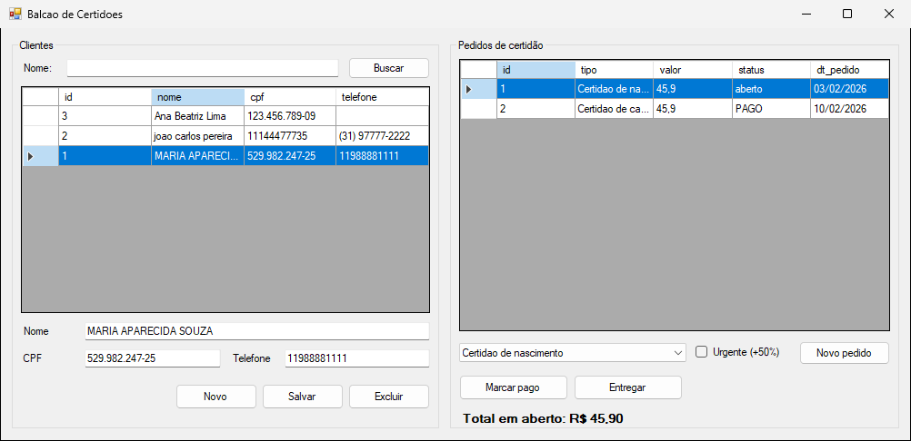
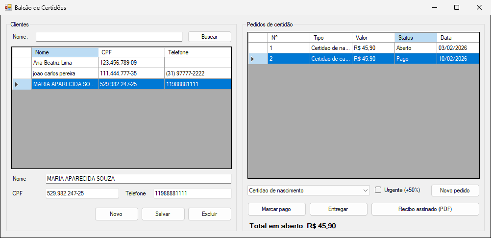
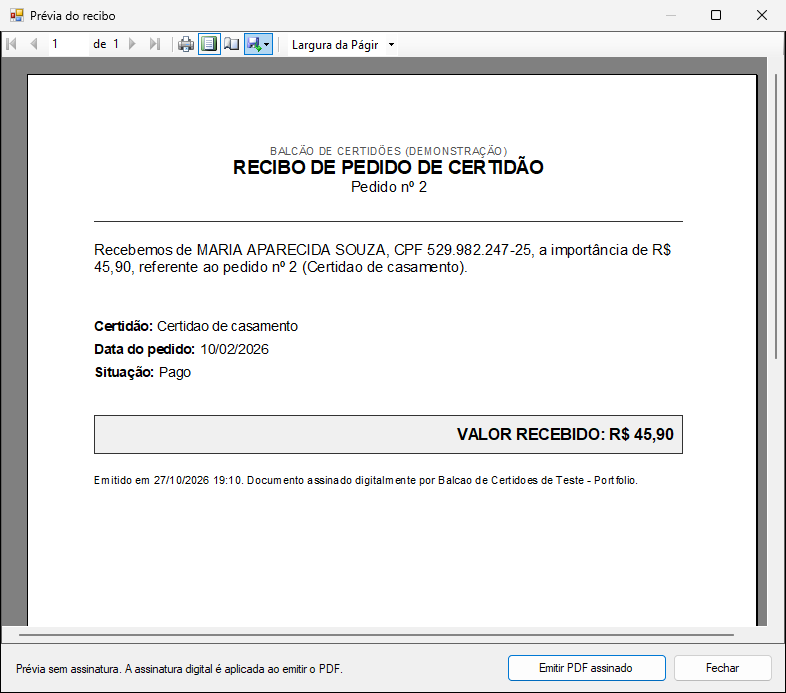

# Refatoração de um sistema legado

Um app WinForms (.NET Framework 4.8) para pedidos de certidão, escrito do jeito que costuma aparecer em sistema antigo:

- SQL concatenado dentro dos eventos de clique;
- connection string fixa no código;
- dinheiro em `double`;
- controles chamados `button1`, `textBox2`.

Ele é refatorado em etapas até chegar a camadas, MVP e testes. Cada etapa é uma branch e um pull request, e as branches alteram só esta pasta.

| Antes (`main`) | Depois (`refatoracao/05-emissao-documentos`) |
|---|---|
|  |  |

## Etapas

1. `refatoracao/01-sql-parametrizado`: SQL parametrizado, `using` e connection string no App.config. O comportamento não muda.
2. `refatoracao/02-camada-dados`: o acesso a dados vai para repositórios e o Form deixa de usar `SqlConnection`.
3. `refatoracao/03-camada-negocio`: as regras saem do Form, entram os testes (49) e os bugs abaixo são corrigidos.
4. `refatoracao/04-mvp`: o Form vira uma view, o presenter assume as decisões e os controles ganham nomes (61 testes).
5. `refatoracao/05-emissao-documentos`: recibo do pedido em PDF assinado, com prévia (72 testes).

Os bugs só são corrigidos na etapa 3, depois que existem testes. Nas etapas 1 e 2 o comportamento fica igual de propósito, para que cada PR seja fácil de revisar.

## O que estava errado no legado

- A busca por nome concatenava o texto digitado no SQL, então `' OR 1=1 --` listava tudo.
- As conexões não eram fechadas quando havia exceção.
- O valor ia para o SQL com `ToString().Replace(",", ".")`, o que dependia da cultura do Windows.
- "Marcar pago" comparava `status != "aberto"` diferenciando maiúsculas. Pedidos gravados como `Aberto` ou `ABERTO` nunca podiam ser pagos.
- "Entregar" só bloqueava pedido já entregue, então era possível entregar um pedido não pago.
- O CPF duplicado só era detectado se fosse digitado igual. `529.982.247-25` e `52998224725` viravam dois clientes.
- O CPF só era validado pelo tamanho, então `abcdefghijk` passava.
- Excluir um cliente deixava os pedidos dele órfãos, porque a tabela não tem chave estrangeira.

## O mesmo botão, antes e depois

Antes, em `Form1`:

```csharp
private void button5_Click(object sender, EventArgs e)
{
    if (dataGridView2.CurrentRow == null) return;
    int idPedido = Convert.ToInt32(dataGridView2.CurrentRow.Cells[0].Value);
    string status = dataGridView2.CurrentRow.Cells[3].Value.ToString();
    if (status != "aberto")
    {
        MessageBox.Show("Pedido nao esta em aberto");
        return;
    }
    try
    {
        SqlConnection con = new SqlConnection(conexao);
        con.Open();
        SqlCommand cmd = new SqlCommand("update tb_pedido_certidao set status = 'pago' where id = " + idPedido, con);
        cmd.ExecuteNonQuery();
        con.Close();
        CarregarPedidos();
    }
    catch (Exception ex) { MessageBox.Show("Erro: " + ex.Message); }
}
```

Depois:

```csharp
// FormBalcao
private void btnMarcarPago_Click(object sender, EventArgs e) => MarcarPagoSolicitado?.Invoke(this, EventArgs.Empty);

// BalcaoPresenter
_view.MarcarPagoSolicitado += (s, e) => Executar(() => AlterarPedido(_pedidos.MarcarPago));

// PedidoServico
public void MarcarPago(int idPedido)
{
    var pedido = Obter(idPedido);
    if (pedido.Status != StatusPedido.Aberto)
        throw new NegocioException("Só pedido em aberto pode ser marcado como pago.");
    _pedidos.AtualizarStatus(idPedido, StatusPedido.Pago);
}

// PedidoRepositorio: o texto gravado no banco vira enum na leitura
Status = FormatosLegados.LerStatus(leitor.GetString(4)),
```

## Decisões

- O banco não muda: o status e a data continuam em texto e o valor continua `FLOAT`. A conversão para `enum`, `DateTime` e `decimal` acontece no repositório, e a gravação mantém o formato antigo. Num sistema legado, outras aplicações costumam ler as mesmas tabelas, e mudar o schema seria outro projeto.
- As interfaces dos repositórios ficam na camada de negócio. Por isso as regras são testadas com repositórios em memória.
- Algumas mudanças de comportamento foram aceitas na etapa 3: CPF validado de verdade, exclusão de cliente com pedidos bloqueada e entrega só depois do pagamento.

## Recibo (etapa 5)

Com o pedido pago, o botão "Recibo assinado (PDF)" abre a prévia no ReportViewer e gera o PDF assinado com iText. Como a lógica já estava separada, essa parte não precisou mexer em SQL nem em evento de botão. Exemplo gerado: [docs/exemplo-recibo-assinado.pdf](docs/exemplo-recibo-assinado.pdf).



## Como rodar

Na pasta `04-refatoracao-legado`:

```bash
cp .env.example .env
docker compose up -d
```

O banco sobe na porta 14334 com os dados no estado do legado: CPF com e sem pontuação, status com maiúsculas misturadas, data em texto e um pedido de cliente inexistente.

Para rodar, abra `src/Legado.sln` no Visual Studio 2022. Para ver cada etapa, troque de branch, por exemplo `git checkout refatoracao/03-camada-negocio`. Os testes, a partir da etapa 3, rodam com:

```bash
dotnet test src/Legado.sln
```

Os PRs devem ser abertos na ordem e mesclados com merge commit, não com squash, para que cada um mostre só a própria etapa.
