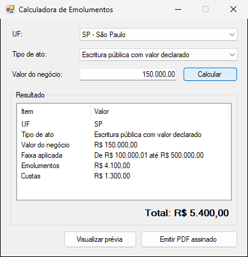
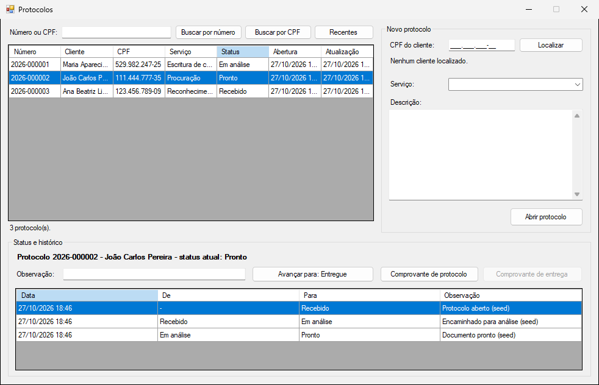

# Projetos de portfólio

Quatro projetos em C# com .NET Framework 4.8, WinForms e SQL Server, voltados para sistemas de cartório.

| Projeto | Conteúdo |
|---|---|
| [01-calculadora-emolumentos](01-calculadora-emolumentos/) | Cálculo de emolumentos por UF com MVP, testes e demonstrativo em PDF assinado |
| [02-protocolo-cartorio](02-protocolo-cartorio/) | Protocolo e atendimento em camadas com EF6, comprovantes assinados e relatório RDLC |
| [03-migracoes-idempotentes](03-migracoes-idempotentes/) | Migrador de scripts SQL para SQL Server e PostgreSQL |
| [04-refatoracao-legado](04-refatoracao-legado/) | Refatoração de um WinForms legado, uma branch por etapa |

<p>
  
  
</p>

## Requisitos

- Windows com Visual Studio 2022 (carga de trabalho ".NET desktop development") ou o .NET SDK para compilar e testar
- Docker Desktop, para os bancos de dados

## Como rodar

Cada projeto tem o próprio `docker-compose.yml`, que sobe apenas o banco. Os apps rodam no Windows.

```bash
cd 01-calculadora-emolumentos
cp .env.example .env
docker compose up -d
dotnet test src/Emolumentos.sln
```

Cada banco usa uma porta diferente (14331 a 14334, e 54333 para o PostgreSQL), então os quatro podem rodar ao mesmo tempo. O README de cada projeto traz os detalhes.

## Branches

A `main` tem os projetos 1 a 3 completos e o projeto 4 na versão legada. A refatoração do projeto 4 está nas branches `refatoracao/01-sql-parametrizado` a `refatoracao/05-emissao-documentos`, que alteram somente a pasta `04-refatoracao-legado`.
